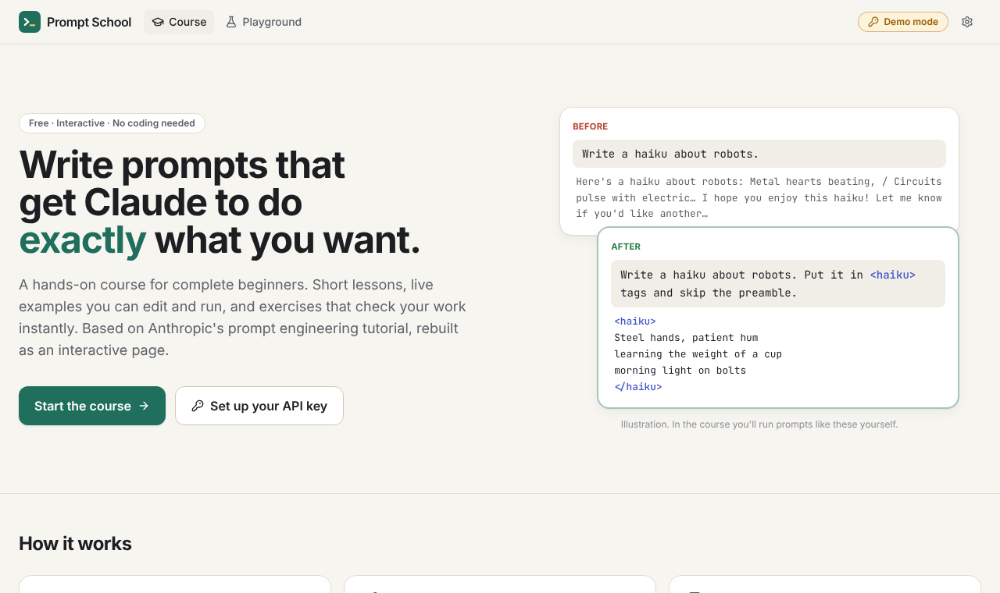

# Prompt School

**An interactive, beginner-friendly prompt engineering course for Claude.** Short lessons, live prompt playgrounds you can edit and run, and exercises that check your work instantly. No coding required.

It's a rebuild of Anthropic's [Prompt Engineering Interactive Tutorial](https://github.com/anthropics/prompt-eng-interactive-tutorial) (Jupyter notebooks and a Google Sheet) as a single web page, rewritten in plain language for newcomers and updated for current Claude models.



## What's inside

- **13 chapters**: 9 core chapters plus 4 appendix chapters, from "what is a prompt" to tool use and evals.
- **Live playgrounds**: every example is editable and runnable, with `{PLACEHOLDER}` templates, a "what Claude actually receives" preview, streaming answers, token and cost counts, and a **View as code** tab (Python/TypeScript) for the exact API call.
- **Auto-graded exercises**: a checklist of what the checker looks for, hints that unlock one at a time, sample solutions, and multi-input exercises graded per case.
- **Interactive widgets**: a message-anatomy explorer, a 10-element prompt builder, a prompt-chain runner, real tool use with tools that run in your browser, and a retrieval (RAG) sandbox.
- **Quick-check quizzes** that work without an API key.
- **Progress tracking**, light/dark themes, and layouts that work on a phone.

| Level | Chapters |
|---|---|
| Beginner | 1 Basic Prompt Structure · 2 Being Clear and Direct · 3 Assigning Roles |
| Intermediate | 4 Separating Data from Instructions · 5 Formatting Output · 6 Thinking Step by Step · 7 Using Examples |
| Advanced | 8 Avoiding Hallucinations · 9 Building Complex Prompts |
| Beyond prompting | 10.1 Chaining Prompts · 10.2 Tool Use · 10.3 Search & Retrieval · 10.4 Testing Your Prompts |

## How learners use Claude

Learners bring their own [Anthropic API key](https://platform.claude.com/settings/keys). The key is stored only in their browser (localStorage if they choose "remember", otherwise sessionStorage), and requests go **directly from the browser to Anthropic's API**. There's no server, so hosting costs nothing and nobody else's key is ever involved.

The default model is **Claude Haiku 5.5** ($0.10 / $0.50 per million input/output tokens), so working through the whole course costs a few cents. Learners can switch to Sonnet 5.5 or Opus 5.5 in Settings.

**No key?** Demo mode still lets people read every lesson, take the quizzes, and see recorded answers for the lesson examples (see below).

## Security

The whole design goal is that a learner's API key never goes anywhere except Anthropic.

- **No server, no third parties.** The site is static. The built page loads no external scripts, styles or fonts, and makes no network requests other than to `https://api.anthropic.com` with the learner's own key.
- **Content-Security-Policy.** The build bakes a CSP `<meta>` tag into `index.html` (`cspMeta` in `vite.config.ts`): scripts only from the site itself, and `connect-src` limited to Anthropic. Even if a script-injection bug were ever introduced, it could not send the key elsewhere.
- **Nothing is rendered as HTML.** Lesson text goes through react-markdown with raw HTML disabled; prompts and Claude's answers are rendered as plain text, never as markup.
- **Key storage.** "Remember on this device" keeps the key in `localStorage`; otherwise it lives in `sessionStorage` and is gone when the tab closes. Settings shows only the last four characters. Anyone who can run code in the learner's browser on this site's origin (a browser extension, or a person at an unlocked shared computer) could read it, which the key dialog warns about.
- **Shared origin on github.io.** `localStorage` is per origin, and every project site under the same `<user>.github.io` shares one origin. If you host other projects on the same GitHub Pages account, their scripts could read a key saved here. Serving the course from its own custom domain avoids that.
- **Recommendation for learners** (shown on the setup page): create a dedicated key for the course and set a spend limit on it in the Claude Console.

Found a problem? Please open an issue.

## Run it locally

Needs Node 22+.

```bash
npm install
```

```bash
npm run dev
```

Then open the URL Vite prints (by default http://localhost:5173/Prompt-Engineering-Tutorial/).

## Record demo answers

Demo mode shows real Claude answers for the unedited lesson examples. They're recorded from the API, never hand-written. To record them (costs a fraction of a cent on Haiku 5.5):

```bash
ANTHROPIC_API_KEY=sk-ant-... npm run record-demos
```

This fills `src/content/demo-responses.json`; commit it. Recordings are keyed by a hash of each prompt, so when you edit a lesson example, only that example gets re-recorded the next time you run the script. Use `-- --dry-run` to see what would be recorded and `-- --force` to re-record everything.

## Deploy to GitHub Pages

1. In the repository's **Settings → Pages**, set **Source** to **GitHub Actions** (one time).
2. Push to `main`. The workflow in `.github/workflows/deploy.yml` runs the tests, builds, and publishes to `https://<owner>.github.io/<repo>/`.

The site uses hash-based URLs (`#/learn/...`), so deep links work on Pages without any server configuration. To host it at a different path, build with `BASE_PATH=/your/path/ npm run build`.

## Tests

```bash
npm test
```

Unit and content tests (Vitest): graders, templates, request building, retrieval, tools, and checks that every lesson example is valid and every sample solution passes its own prompt checks.

```bash
npm run e2e
```

End-to-end tests (Playwright) that mock the Anthropic API: page rendering on a phone, streaming, grading, hints, multi-input exercises, tool use, chaining, error messages and demo mode.

## Project structure

```
src/
  content/
    chapters/*.ts       one file per chapter: lesson text, examples, exercises, graders, hints, quiz
    course.ts           chapter order and progress helpers
    types.ts            the content model
    docs/ tools.ts retrieval.ts chains.ts builder.ts   data for exercises and widgets
    demo-responses.json recorded answers for demo mode
  components/           playground, editor, exercise card, quiz, widgets (components/custom)
  lib/                  Claude client, graders, templates, storage, tool-use loop
  pages/                home, setup, chapter, playground, settings
scripts/record-demos.ts
tests/  e2e/
```

Chapters are plain TypeScript data, so adding or editing a lesson doesn't touch any UI code. A chapter is a list of sections made of blocks: `text`, `callout`, `playground`, `compare`, `exercise` and `custom`. Graders are small, readable helpers (`contains`, `containsAny`, `exactly`, `minWords`, `usesVariable`, …) in `src/lib/graders.ts`.

## What changed from the original tutorial

The original was written for Claude 3, and Anthropic now says to follow its [Prompting best practices](https://platform.claude.com/docs/en/build-with-claude/prompt-engineering/claude-prompting-best-practices) where the two differ. This course follows them:

- **Thinking and effort.** Current models think before answering on their own. Chapter 6 teaches the effort setting and how to point Claude's thinking at what matters, instead of "think step by step" and reasoning written into the answer. Playgrounds use adaptive thinking and let learners change the effort level.
- **Prefill** is no longer accepted, so Chapter 5 teaches steering the start of an answer with instructions, and demonstrates structured outputs (schema-guaranteed JSON).
- **Explain why** (Chapter 2): giving the reason behind an instruction lets Claude generalize it.
- **Say what you want, calmly** (Chapter 5): positive instructions, matching the prompt's style to the output, and no ALL-CAPS pressure language.
- **Prompt injection and guardrails**: treating outside text as data (Chapter 4) and keeping a chatbot to its rules when users push back (Chapter 9).
- **Long documents first, question last** (Chapter 8), and the nested `<document>` structure for retrieval (10.3).
- **Self-correction chains** (10.1): draft → review against criteria → refine, plus when chaining is still worth it.
- **Chapter 9's structure is a checklist, not a template**: start minimal and add elements only to fix problems you see.
- **Success criteria and testing** are introduced in Chapter 1 instead of only at the end.
- **Temperature** can't be changed on current models, so answers vary run to run. Graders are a little more tolerant, and the UI encourages re-running.
- **Tool use** uses the API's real tool calling instead of the simulated XML version.
- The Chapter 8 Beyoncé question became answerable (her eighth album came out in 2024), so it was replaced with a question that's still a hallucination trap.

## Credits

Exercise scenarios, example prompts and sample documents are adapted from Anthropic's [prompt-eng-interactive-tutorial](https://github.com/anthropics/prompt-eng-interactive-tutorial) (the Amazon Bedrock edition in that repository is MIT-0 licensed). Lesson text was rewritten for beginners. This project is unofficial and not affiliated with or endorsed by Anthropic.
